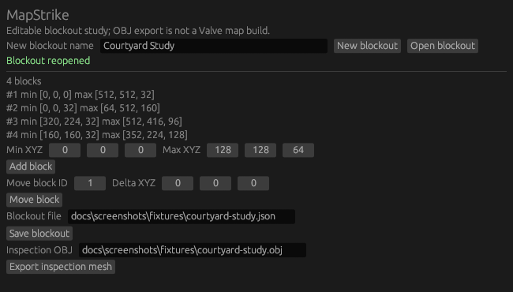

  

<h1 align="center">MapStrike</h1>

  <a href="https://prowebdevsolutions.com"><picture>
    <source media="(prefers-color-scheme: dark)" srcset="assets/branding/PWDS-logo-orange.svg">
    
  </picture></a>

**Lay out the space before the details.**

MapStrike gives early map ideas a simple geometric form. Place and move boxes in a named blockout, save the layout, and export an OBJ to inspect elsewhere; a separate tool can inventory an existing map folder.

## Native renderer preview

This 650 x 370 image is a direct egui capture of the current form-based blockout UI with a [synthetic saved document](docs/screenshots/fixtures/courtyard-study.json). The evidence-only capture helper is in [draft PR #1](https://github.com/Gerbzz/MapStrike/pull/1); the application UI source is unchanged from `main`. This is a renderer view, not a record of pointer use or a 3D map preview. [Capture provenance and limits](docs/screenshots/README.md) identify the exact source, build, and fixture.

## Highlights

- Build and revise box-based layouts.
- Save a versioned blockout document.
- Export OBJ geometry or inventory source files.

## Current status

Early source prototype. The blockout model, CLI, and first desktop window have headless coverage, but visual workflow and clean-machine packaging remain open. It does not compile playable CS2 maps or round-trip Valve map formats.

## Two focused workflows

### Build a box layout

Create a named blockout, add axis-aligned boxes with integer minimum and maximum coordinates, and move a box by its ID. The document validates positive width, depth, and height, and protects against coordinate or ID overflow. Save and reopen the versioned JSON document; export its boxes as triangle geometry in a new OBJ file.

The desktop UI exposes this layout workflow. The OBJ is intended for inspection or further experimentation. It is not a compiled map, collision package, navigation mesh, or game-ready asset.

### Inventory an existing map folder

Point the CLI at a project root and a <code>.vmap</code> file inside it. MapStrike records the relative map path and hashes recognized source assets into a JSON snapshot. It does **not** parse VMAP geometry or modify any source asset. The inventory rejects linked files that require separate review.

| File | Role |
| --- | --- |
| Blockout <code>.json</code> | Editable name and box coordinates, schema version 1 |
| Export <code>.obj</code> | New inspection mesh generated from the blockout |
| Snapshot <code>.json</code> | Relative paths, byte lengths, and SHA-256 hashes of selected source files |
| Source <code>.vmap</code> | Input to inventory only; never treated as an editable MapStrike document |

## Data checks behind the workflow

A blockout is a small schema-versioned model, not a text export from Hammer. Each box has a stable numeric ID and opposing minimum/maximum corners. Moving a box checks the resulting coordinates before saving, and JSON writes are staged so an error does not silently replace the previous document.

The inventory accepts a map file within the selected root and recognizes <code>.vmap</code>, <code>.vmat</code>, <code>.vmdl</code>, <code>.fbx</code>, <code>.obj</code>, <code>.tga</code>, and <code>.png</code> source assets. Its report is an audit of paths, sizes, and hashes; it makes no claim about whether those assets will compile or load in the game.

## Build and run

Use Windows and a Rust toolchain that supports edition 2024. The native window uses Rust egui/eframe components.

~~~powershell
cargo test --locked --features native-ui
cargo build --locked --features native-ui --bins
cargo run --locked --features native-ui --bin mapstrike-ui
~~~

The CLI exposes both workflows. Choose new paths for the JSON document and OBJ output:

~~~powershell
cargo run --locked --bin mapstrike -- new-blockout <name> <new-document.json>
cargo run --locked --bin mapstrike -- add-block <document.json> <x0> <y0> <z0> <x1> <y1> <z1>
cargo run --locked --bin mapstrike -- move-block <document.json> <id> <dx> <dy> <dz>
cargo run --locked --bin mapstrike -- export-obj <document.json> <new.obj>
cargo run --locked --bin mapstrike -- snapshot <project-root> <map.vmap> <new-report.json>
~~~

The first three commands update the blockout document; export creates a separate file and refuses an existing destination. The snapshot is read-only with respect to the source folder.

## What is still open

The geometry vocabulary is intentionally limited to boxes. MapStrike does not yet edit VMAP content, compile a playable level, validate Counter-Strike materials, generate lighting or navigation, or round-trip through Valve tools. Visual workflow review and clean-machine packaging have not passed acceptance.

A broader brush/mesh editor, richer project organization, real map-format interchange, and in-game validation are possible directions. They are not part of this published prototype.

This repository grants no public license for its project source. Third-party crates retain their own licenses.

## PWDS brand artwork

The company mark in this masthead is the existing [official PWDS logo](https://github.com/Gerbzz/PWDS-Website/blob/main/public/prowebdevsolutions-logo.png), with the [official orange display asset](https://prowebdevsolutions.com/images/prowebdevsolutions-logo-orange.svg) for dark backgrounds. Any app logo above it remains the original Strike suite artwork.
